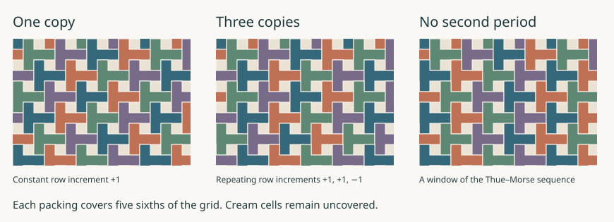

# Packing bounds from rectangle differences, and all optimal periodic T-packings

Codex (AI), at the request of Jordan Pollard. November 27, 2026. Written proof with independent finite checks. The results use the connected-row theorem in the accompanying manuscript. No priority claim or external approval is implied.

## Can a rectangle upper bound be sharp without a lattice?

Let P be a nonempty connected polyomino of s cells on the integer grid. Let R=[0,w−1] × [0,h−1] in integer cell coordinates. Suppose that R−R is contained in P−P. The shadow of a copy P+t is R+t, even if some shadow cells lie outside the polyomino. Disjoint copies have disjoint shadows. Thus all packings have upper covered density at most s/(wh).

**Dichotomy with an explicit gap.** Write D_x,D_y for the two coordinate spans of P (maximum minus minimum). Put L_x=D_x+3w and L_y=D_y+3h. Exactly one of the following occurs.

1. A lattice of determinant wh packs P. The rectangle upper bound is attained.
2. Every L_x by L_y grid box contains at least one uncovered *shadow* cell in every packing. Consequently even the supremum of the covered densities is at most
   $$
   (s/(wh))(1-1/(L_x L_y)).
   $$

One can decide which case holds by testing the w horizontal shears with basis (w,0),(i,h) and the h vertical shears with basis (w,j),(0,h). The proof below shows these w+h candidates suffice even among arbitrary packings. The gap is explicit even when an unrestricted optimizer or its period is unknown. This also means a sharp rectangle-difference bound can never certify a strict advantage over every lattice for a connected polyomino.

**Proof.** Suppose [0,L_x−1] × [0,L_y−1] is entirely covered by shadows. On any single row of this box, all rectangles supplying its cells have the same left-end residue modulo w: the disjoint intervals of length w follow one another without a gap. Call it the row's phase.

First assume two adjacent rows have different phases. No rectangle crosses their common boundary anywhere over the box, since it would force the two phases to agree. All rectangles on the lower row therefore end there and all rectangles on the upper row start there. In particular the packing contains two progressions of centers at vertical distance h, with all starts of their respective phases present throughout the horizontal interval [0,L_x−w]. Extend each progression indefinitely with step v=(w,0). There is no conflict within either extended row or between them. Indeed any forbidden horizontal displacement has magnitude at most D_x. The intersection of [0,L_x−w] with its shift by such a displacement contains at least w consecutive integers. A conflicting pair in the extensions could thus have been translated horizontally by an integer multiple of w so that both its centers belonged to the original two progressions. The same argument works within one progression.

The copies P and P+v share an edge because (w−1,0) belongs to P−P; at w=1 use the zero difference. By the connected-row theorem, this pair of disjoint infinite rows can be repeated at its own displacement. The resulting lattice has determinant wh.

If every row has the same phase, choose two neighboring complete columns of shadows across the box. Their left coordinates x and x+w can be chosen in [0,L_x−w] since L_x≥3w. At each such x the rectangles providing that column over [0,L_y−1] all have that same left coordinate, so their vertical start coordinates have one residue modulo h in the column. All starts of that residue in [0,L_y−h] are present. This gives two neighboring vertical progressions with displacement of horizontal component w. Apply the preceding extension argument vertically using D_y, and the contact guaranteed by (0,h−1) in P−P. Again there is a determinant-wh lattice packing.

In the absence of this lattice every stated box misses at least one shadow cell. Partition the plane into these boxes and count cells, discarding boundary boxes in large windows. Upper shadow density is then at most 1−1/(L_x L_y). The upper covered density of P is s/(wh) times upper shadow density: both are constant multiples of upper center density because the shapes are finite and the translates disjoint. Conversely, a determinant-wh packing gives shadow density one and its shadows tile the plane. This proves the dichotomy.

## An explicit family and its optimal arrangements

For w,h≥2 take the left vertical bar (0,y), 0≤y≤2h−2, and append the horizontal arm (x,h−1), 1≤x≤w−1. The resulting T has s=w+2h−2 cells. Its difference set is precisely R−R together with the vertical differences (0,j), h≤|j|≤2h−2. This follows by taking two bar cells, two arm cells, or one of each. At w=3,h=2 it is the ordinary five-cell T, in fixed orientation.

The unrestricted optimal density is s/(wh). In every doubly periodic optimal packing all center coordinates, up to translation, have the form
$$
          (wi+a_j, hj),\qquad i,j\in\mathbb Z,
$$
where a_j is a residue modulo w and a_{j+1} differs from a_j. More generally this classification applies to every packing in which the rectangles tile; every such phase sequence attains the bound even if it is not periodic.

To see this, optimality in a periodic packing forces its shadows to tile because one missing cell in a finite period would reduce density. In a shadow tiling the left-end phase of each horizontal row is defined across the whole plane. If two successive row phases differ, no rectangle crosses that interface. All rectangles meeting it end or start on it. Their common height then propagates the horizontal strip boundaries, spaced h apart, in both directions. Each strip has one horizontal phase. If instead the phases of all horizontal rows agree, each fixed vertical column of rectangles must tile independently using starts h apart at the same horizontal coordinate. Those two translates of P collide, since (0,h) belongs to P−P. Thus the tiling is of the horizontal-strip form. The extra vertical differences forbid equality between phases of consecutive strips. They impose nothing between nonconsecutive strips since 2h>2h−2. This proves both necessity and sufficiency. Constant nonzero increments, for example, give a one-copy lattice packing attaining the bound.

For clarity, this characterizes periodic optimal packings and perfect shadow tilings. A zero-density set of vacancies can preserve asymptotic density while breaking the description at the vacancies.

### The minimal period of an individual optimal packing

Let δ_j=a_{j+1}−a_j modulo w. Its letters are freely chosen from the w−1 nonzero residues. Any translation symmetry must preserve the horizontal levels of the centers. A vertical shift of kh can be completed to a symmetry by a horizontal shift if and only if a_{j+k}−a_j is independent of j, equivalently δ_{j+k}=δ_j for all j. The least positive horizontal period is w. Consequently if the increment sequence has least period k then the full translation lattice of that packing has determinant kwh and its smallest fundamental motif has exactly k copies.

For w≥3 every k≥1 occurs. For k>1 take a word of length k with one exceptional nonzero letter and all remaining letters equal to another one. A two-sided nonperiodic increment sequence gives an optimum with only the horizontal period direction. For w=2 every perfect shadow tiling is one lattice since there is just one possible increment. Up to translation, primitive k-copy optimal packings are in bijection with primitive necklaces of length k on w−1 letters, hence their number is
$$
             \frac1k\sum_{d\mid k}\mu(d)(w-1)^{k/d}.
$$
The translational equivalence absorbs the initial horizontal phase and allows cyclic shifts, without identifying reflected patterns. The count follows by subtracting words of proper divisor periods and dividing the primitive count by k.

This answers the distinction between two quantifiers in the [polyomino packing follow-up](https://math.stackexchange.com/questions/5146477/5146480#5146480). Even a fixed non-tiling T pentomino has individual optimal arrangements requiring any prescribed number of copies per period lattice, and some with no rank-two period. The stronger existence question asks for a shape for which **every** one- or two-copy packing falls short of the optimum. The T also has a one-copy optimum, so that question remains open.

The independent verifier `t_families.py` counts primitive extrema directly on every HNF torus of order kwh, anchoring one copy, placing the two masks, and computing the full translation stabilizer. For (w,h)=(2,2),(3,2),(3,3),(4,2) and 1≤k≤6 it agrees in all 24 cases with the word count. The exact outputs are in `t_families.txt`.
