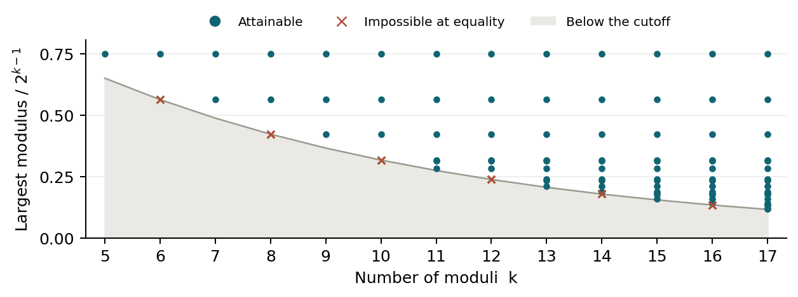

# Which integers can be the largest modulus of an irreducible cover?

*Jordan Pollard, November 27, 2026*

Jordan Pollard directed the project. OpenAI Codex and collaborating AI agents developed the proofs and wrote the manuscript.

## The result

A finite set of distinct moduli greater than one is **irreducible** if some choice of one residue per modulus covers all integers and no proper subset can do so for any choice of residues. Write $k$ for its size and $m$ for its largest modulus. Erdős asked about the extremes of $m$ in 1980, on printed page 95. We determine which values $m$ can take throughout a sharp upper range, and determine the entire set of ratios $m/2^{k-1}$ obtained as $k$ varies.

Write $m=2^a u$ with $u$ odd. Set
$$
 f(n)=\sum_{p^e\parallel n} e(p-1),\qquad
 d=k-1-a-f(u).
$$

**Theorem 1.** Every irreducible covering set satisfies $u>1$, $d\ge0$, and $d\ne1$ if $u$ is prime. For every fixed $k$ and every integer
$$
                        m>\tfrac23\,3^{k/2},
$$
these conditions are also sufficient. There are infinitely many failures of sufficiency at equality.

**Theorem 2.** Fix an odd $u>1$ and a nonnegative integer $d$. The ratio $u/2^{f(u)+d}$ occurs for some $k$ precisely when $u$ is composite or $d\ne1$. Every permitted ratio occurs for all sufficiently large $k$. These are all possible ratios. The proof gives explicit moduli and residues. Section 8 gives an exact factorization test at zero defect, including below the cutoff in Theorem 1.

For instance, at $k=8$ the cutoff is $54$. Exactly $72$ and $96$ occur above it. At $k=9$, $96$ cannot be the largest modulus: $96=2^5\cdot3$ gives the prohibited value $d=1$. At $k=8$ precisely 26 different sets attain $96$. A set is counted once regardless of how many residue assignments work.

The unrestricted maximum $3\cdot2^{k-3}$ for $k\ge5$ already appears in Öztürk's 2026 preprint. Simpson's published least-common-multiple bound is the external theorem used in the proof. We make no claim of priority for the classification. The exact general minimum in the paired project statement is outside this result.

## 1. The two necessary obstructions

Put $L=\operatorname{lcm}(S)$. Any covering choice on an irreducible set is minimal with its residues fixed. Simpson's bound gives
$$
                            f(L)+1\le k.
$$
As $m\mid L$ and $f$ is additive on products, this gives $d\ge0$. A largest modulus cannot be a prime power $p^a$. All smaller moduli then divide $L/p$. Upon removing $p^a$, some residue modulo $L/p$ must be missed. Its $p$ lifts modulo $L$ cannot be covered by one residue modulo $p^a$. This rules out $u=1$ for all $a$ (the modulus 1 itself is excluded).

The remaining obstruction is stronger. If $u=p$ is an odd prime and $d=1$, then $f(L/m)\le1$, so $L=m$ or $2m$. The classification below shows that when $L=2^b p$, every irreducible set has $b+p$ elements and contains $2^b p$. Neither possibility allows $k=a+p+1$ and largest modulus $2^a p$.

## 2. An exact coverage formula and the sets with period $2^a p$

Take a strict divisibility chain $1=c_0\mid c_1\mid\cdots\mid c_A$, and any integer $q\ge2$ coprime to $c_A$. Choose arbitrary moduli $c_i$ for $i\in I\subseteq\{1,\ldots,A\}$ and $q c_j$ for $j\in J\subseteq\{0,\ldots,A\}$. Put $P=\sum_{i\in I}1/c_i<1$ and $H=1-P$. Sort the weights $1/c_j$, $j\in J$, in decreasing order. Keep the first $q-1$ as separate loads (padding with zeros), and let the last, $q$th, load be the sum of all the remaining weights. Denote the resulting list by $w_1,\ldots,w_q$. Then the exact maximum covered density is
$$
                     P+\frac{1}{q}\sum_{r=1}^{q}\min(H,w_r).
$$

Indeed, in the Chinese remainder coordinates modulo $q$ and $c_A$, a pure class serves every row and a mixed class serves just one row. For any assignment of mixed classes to rows with loads $v_r$, the covered fraction is at most $P+q^{-1}\sum\min(H,v_r)$. The sum of the largest $t$ row loads is at least the sum of the largest $t$ individual weights for $1\le t<q$. Each weight exceeds the sum of all later weights, since the ratios in the chain are at least two and the chain is finite. The displayed list $w$ is therefore decreasing and achieves the least possible value of every proper leading partial sum. For descending loads the total excess above $H$ equals $\max_{0\le t\le q}(\sum_{r\le t} v_r-tH)$. Subtracting this excess from the common total load proves the bound.

It is attained. In the order of the mixed-radix digits from least significant to most significant, a congruence modulo $c_i$ is an aligned block of width $1/c_i$ in the reordered unit interval. Place pure classes contiguously from the left, in decreasing widths. Give the first $q-1$ mixed classes distinct rows, with all remaining mixed classes in the last row. Place their blocks from the right, again in decreasing widths. Every block starts at a legal boundary because each preceding width is an integer multiple of its width. Each row load is at most one, including when the weight $1$ is present. The formula follows. This supplies a constructive family for the maximum-density question in Erdős #278.

In the binary chain $c_i=2^i$, a full cover requires at least $q$ mixed classes. Reserve the first $q-1$ of them and call the others the tail. Since its sum is the least row load, the exact covering test is
$$
             \sum_{i\in I}2^{-i}+\sum_{j\text{ in tail}}2^{-j}\ \ge\ 1.
$$
For an irreducible set equality is necessary. Write $a$ for the largest used exponent. A term of value $2^{-a}$ occurs on the left, either pure or in the tail, and all terms are integer multiples of it. With strict inequality it could be removed while retaining a cover. Conversely, at equality removing any displayed term destroys coverage, and removing a reserved term moves the first tail term into the reserve, which also destroys coverage. If the number of remaining mixed terms drops below $q$, a row receives no mixed class and stays incomplete.

The binary expansion of 1 on this left side has at most two summands at each positive level and uses level $a$. It must have precisely one at every level $1,\ldots,a-1$ and two at $a$. In the first undecided position, using zero makes even the full finite tail too small, and using two completes the remaining mass. No term of exponent zero occurs on the left.

This gives a bijection. Choose any subset $W\subseteq\{0,\ldots,a-1\}$ of size at least $q-1$. Use mixed moduli at $W\cup\{a\}$. Use pure moduli at $1,\ldots,a$, except where a member of $W$ lies strictly after its $(q-1)$st smallest element. These and only these sets are irreducible in this family. All have $a+q$ members, and all contain the maximum $q2^a$. Their number is
$$
                            \sum_{j=q-1}^a\binom aj.
$$
For an odd prime $q=p$ the family contains every eligible divisor of $2^a p$. For $q=3$, Simpson's inequality implies that every global maximizer has exactly this period: it contains $3\cdot2^{k-3}$ and that modulus exhausts the budget $f(L)\le k-1$. The known maximum itself follows since an all-dyadic distinct set has reciprocal sum below one and each odd prime factor in $L/2^{f(L)}$ contributes at most $3/4$. The construction attains this value for $a=k-3\ge2$. Consequently there are exactly $2^{k-3}-k+2$ globally maximizing sets.

## 3. Operations preserving irreducibility

**Splitting a congruence.** Suppose $e\in S$ and $p$ is prime with $v_p(e)=v_p(L)$, possibly zero. Choose $p$ distinct divisors $h_1,\ldots,h_p$ of $e$, each carrying its full $p$-part, including $e$ itself. Replace $e$ by $ph_1,\ldots,ph_p$. The resulting set is irreducible and has $p-1$ additional moduli. Öztürk's Theorem 5.1 gives the coprime-period move. The full-valuation version allows repeated use of the same prime.

To retain a cover, split $r\pmod e$ into the $p$ residues $r+je\pmod{pe}$ and enlarge each resulting class to its corresponding modulus $ph_i$. New moduli are distinct from the old ones by their $p$-valuation. For the converse, allow all residues to be chosen again. In a proposed cover using a subset of the new list, the retained old classes miss some $y\pmod L$ by irreducibility. Its $p$ lifts modulo $pL$ are missed by all those classes. Each new class hits at most one lift since $\gcd(ph_i,L)=h_i$ and $p\nmid L/h_i$. Thus all $p$ new moduli are needed. For *each* base site missed by the old classes, one of its lifts must lie in the class with modulus $pe$. Reducing that class modulo $e$ covers every missed base site. If an old modulus had also been omitted, this would give a covering proper subset of the original set. This proves the claim.

**Doubling.** Replace $S$ by $\{2\}\cup\{2m:m\in S\}$. Give modulus 2 the odd integers and the doubled moduli the doubled residues on the even integers. For any new covering assignment containing modulus 2, restrict to the other parity and divide by two. The old moduli used there must form all of $S$, by irreducibility. Without modulus 2, both parities would separately require all of $S$, an impossibility since each doubled modulus serves only one parity. Thus size increases by one and the largest modulus doubles. Agrawal and coauthors use this operation on systems with fixed residues.

**A starting construction at zero defect.** Write $u=p_1\cdots p_b$ with the odd primes repeated according to multiplicity, and $u_j=p_1\cdots p_j$, $u_0=1$. Choose $a\ge\max(p_j-1)$. Start with the $a$ pure binary classes $2^{i-1}\pmod{2^i}$, leaving the zero class modulo $2^a$. At step $j$, split the current zero class modulo $2^a u_{j-1}$ into $p_j$ subclasses modulo $2^a u_j$. Keep the zero subclass for the next step. Enlarge the other $p_j-1$ subclasses using any distinct moduli $2^i u_j$, $0\le i\le a$. At the final step exclude $i=a$ from these choices and keep the final zero subclass as its own modulus $2^a u$. At earlier steps $i=a$ is allowed. The intermediate copy of that modulus attached to the zero subclass will be split again.

All permanent moduli are distinct. The resulting set has $a+f(u)+1$ members, maximum and period $M=2^a u$. To prove irreducibility, take any covering subset minimal with its chosen residues, and let its period be $D\mid M$. Among the moduli other than the last, at most $f(D)$ divide $D$. Each pure binary class consumes a separate binary exponent, and the $p_j-1$ moduli of stage $j$ require the corresponding occurrence of $p_j$ in $D$. Simpson's bound forces the final modulus to be present. Then $D=M$, and the same bound forces every modulus to be present.

## 4. Realizing every permitted ratio

Each time we increase the size while keeping $2^a u$ as the maximum, the defect increases by the size increment. Subsequent doublings realize the same ratio at every larger size.

*Even defects.* For $d=0$ use the starting construction. For $d=2t>0$ include $4u$ among the permanent moduli of the last stage. Choose $a\ge3$ and $2^a\ge4\cdot3^t$. Split this auxiliary modulus $t$ times at 3, each time continuing on its tripled descendant. At a step with auxiliary modulus $e$, use the divisors $e/4,e/2,e$. All contain its full 3-part, which is also the period's full 3-part. The auxiliary modulus ends at $4u3^t\le2^a u$. Every split adds two moduli.

*Composite $u$, odd defect $d=1+2t$.* There are at least two odd-prime stages. At the first stage include $2^a p_1$ among its permanent moduli. In the final list split this member at 2 using the divisors $2^a$ and $2^a p_1$. Its doubled descendant stays below $2^a u$, as $u/p_1\ge3$. This adds one modulus. If $t>0$, select the separate $4u$ in the last stage and make the $t$ ternary splits just described. The binary split leaves the 3-part of the period unchanged.

*Prime $u=p\ge7$, odd defect $d=3+2t$.* Start with $a\ge\max(5,p-1)$ and make $2^a p\ge12\cdot3^t$. Split the pure modulus $2^a$ at 3 using $4,8,2^a$. This gives $12,24,3\cdot2^a$. Split the last member at 2 using $2^a,3\cdot2^a$. The new maximum from these operations is $6\cdot2^a< p2^a$. These two splits add three moduli. The retained $12$ now has the full ternary exponent of the period and admits the same $t$ ternary splits.

*Primes 3 and 5, odd defect $d=3+2t$.* Two explicit sets start at defect three. In each row the residues are aligned with the listed moduli.
$$
\begin{array}{c|l}
u=3 & 2,3,8,9,12,16,18,24,36,48\\
r &0,0,1,1,11,5,7,5,31,13\\[2pt]
u=5 &2,3,5,8,10,12,15,20,24,30,40\\
r &0,0,0,1,1,7,2,3,13,29,13
\end{array}
$$
Their periods are $144$ and $120$. Section 5 gives their irreducibility certificates. The auxiliary modulus is $36$ for the first set and $12$ for the second. It carries the full 3-part of the period. If a larger maximum is needed, repeatedly split the largest modulus $m$ at 2 using $m/u$ and $m$. This doubles the maximum and adds one modulus on each step, preserving the defect while leaving the auxiliary modulus fixed. Once $3^t$ times that auxiliary modulus is at most the maximum, split the auxiliary modulus $t$ times at 3. This exhausts the allowed cases and proves Theorem 2.

## 5. Finite verification of the two starting sets

The displayed assignments can be checked by substituting each integer of one period. To exclude every reassignment after a deletion, write the period as $Hq$, where $H$ is its binary part. In the row $y\pmod q$, a modulus $m=bt$, $b\mid H$, $t\mid q$ odd, can cover at most $H/b$ sites when $y$ agrees with its chosen residue modulo $t$. In every other row it covers zero. For each deletion, maximize over all odd residue choices the least total capacity of any row. In the order of the deleted moduli above these exact maxima are
$$
\begin{array}{c|l}
H=16 & 8,14,14,14,14,15,14,15,14,15\\
H=8 & 4,6,7,7,7,6,7,7,7,7,7 .
\end{array}
$$
Every entry falls below the row length. Thus even allowing overlaps to count repeatedly cannot repair any deletion.

Start with $q$ zero loads and prior period $v=1$. For each remaining $m=bt$ enumerate $r=0,\ldots,\gcd(v,t)-1$, add $H/b$ to rows $y\equiv r\pmod t$, and continue with $v$ replaced by $\operatorname{lcm}(v,t)$. At the leaves take the least load and then the largest of those values across leaves. The offset restriction is exhaustive up to translation. Translating by a multiple of $v$ fixes all previously selected classes and takes any current offset to its representative modulo $\gcd(v,t)$. The minimum load is invariant under translation.

A second verifier chooses actual residues in the binary tree and retests every deletion without the row-capacity relaxation. A standalone Lean 4.12 file verifies the two positive residue tuples by kernel reduction with no axioms. It also verifies all 21 numerical deletion obstructions twice. One procedure enumerates all normalized rows by compiled evaluation. A second procedure discards a branch when the total outstanding row deficit exceeds the sum of the individual best gains from its remaining moduli. This bound is valid since later placements only decrease the outstanding deficits. The kernel checks this second calculation using propext alone. The independent compiled version's audit also lists Lean.ofReduceBool. The normalization argument and the general theorems here have written proofs.

## 6. The sharp cutoff at a fixed size

Put $\lambda=\log_2(3)/2$, $c=1-\lambda$, and $\Delta_p=\lambda(p-1)-\log_2 p$. For odd primes $\Delta_p\ge0$ with equality at 3, since $\log_2 p/(p-1)$ decreases. For every prime $p\ge5$ we also have $\Delta_p\ge c(p-1)$. It suffices that $p^{1/(p-1)}\le3/2$, which holds at 5 since $5<81/16$, and the left side decreases thereafter. Substituting $k=a+f(u)+d+1$ into the strict threshold in Theorem 1 gives
$$
              a>1+\frac{\lambda}{c}d+
                       \frac1c\sum_{p^e\parallel u} e\Delta_p .
$$
In particular $a\ge2$, $a\ge p-1$ for each $p\mid u$, and $a>1+3d$ because $\lambda/c>3$.

These bounds suffice for every construction at its prescribed exponent. At defect zero the starting construction only needs $a\ge\max(p-1)$. For a ternary branch from $4u$ with $t>0$, we need $a\ge3$ and $a\ge2+t\log_2 3$, both implied since $t\le d/2$. For $p\ge7$ and odd $d\ge3$ we have $a\ge5$ and $2^a p\ge12\cdot3^{(d-3)/2}$. In the two exceptional-prime cases a starting binary exponent of at most 4 suffices before growing the maximum. At most $\lceil t\log_2 3\rceil$ binary doublings suffice for the $t$ ternary steps. The threshold gives $a\ge4+\lceil t\log_2 3\rceil$ for $d=3+2t$. If a construction starts at a smaller exponent, ordinary doubling fills the difference. The resulting set has precisely the input $k$ and $m$.

For sharpness let $m=2\cdot3^b$ and $k=2b+2$, $b\ge1$. Then $d=0$ and $m=\tfrac23\,3^{k/2}$. The budget forces $L=m$. Choose a parity missed by the pure binary modulus if it is present, and either parity otherwise. On that row at most two eligible classes occur at each positive ternary exponent $j$. They cover a fraction at most $2\sum_{j=1}^b3^{-j}<1$. This proves impossibility at equality for infinitely many $k$.

In fact, for the entire defect-zero family $u=p^b$ with $p$ an odd prime and $b\ge1$, the least feasible binary exponent is exactly $p-1$. At defect zero the period must equal $2^a p^b$. Some binary site is missed by all pure binary classes since their total density is below one. On that site all mixed classes together have density at most $(a+1)\sum_{j=1}^b p^{-j}$ in the odd coordinate. This is strictly below one if $a\le p-2$. Section 3 supplies a cover for every $a\ge p-1$. This period feasibility condition also follows from Sun's two-prime covering-number classification.

## 7. The first sixteen values, and the size of the spectrum

For every $k\ge17$ the sixteen largest distinct values of $m$, divided by $2^{k-1}$, are given below in descending order by rank.
$$
\begin{array}{r|r@{\qquad}r|r@{\qquad}r|r@{\qquad}r|r}
1&3/4&5&5/16&9&27/128&13&81/512\\
2&9/16&6&9/32&10&3/16&14&9/64\\
3&27/64&7&243/1024&11&729/4096&15&2187/16384\\
4&81/256&8&15/64&12&45/256&16&135/1024
\end{array}
$$
To enumerate above $1/8$, each prime in $u$ contributes a factor $p/2^{p-1}$. Already $7/64<1/8$, the eighth power of $3/4$ is below $1/8$, and the square of $5/16$ is below $1/8$. Thus only $u=3^i5^j$ with $0\le i\le7$ and $0\le j\le1$ need inspection. Theorem 2 gives exactly the listed ratios. They all have constructions with $k\le17$. For defect zero take $a=\max(p-1)$, for composite odd-part defect one use the same $a$, and for defect two in this table take $a=4$. Doubling completes the claim.

There is also a quantitative rank law. Let $B(x)$ count the distinct ratios in Theorem 2 at least $2^{-x}$. Using natural logarithms outside the binary thresholds,
$$
             \log B(x)\sim \frac{2\pi}{\sqrt3}\sqrt{\frac{x}{\log x}} .
$$
Each exponent of $p$ costs $p-1-\log_2p$ in this count, and $d$ costs one per unit. For the lower bound use $d=0$ and arbitrary partitions into odd primes of sum at most $x$, omitting the empty partition. Their weighted cost is no larger than their ordinary sum, and unique prime factorization gives distinct ratios. The cumulative number of such partitions has the same logarithmic asymptotic as the ordinary prime partition function. Cumulative summation alters the log asymptotic by a lower-order term, and removing the prime 2 loses at most a factor $1+x$ by recording its multiplicity.

For the upper bound fix $0<\epsilon<1$. For every sufficiently large prime the cost is at least $(1-\epsilon)p$. The finitely many smaller odd primes contribute at most a polynomial in $x$ possible exponent lists, since all costs are positive. The same holds for the number of choices of $d$. The remaining ordinary prime partition has sum at most $x/(1-\epsilon)$. Apply the prime-partition asymptotic and then let $\epsilon$ decrease to zero. In particular, for the $j$th largest ratio $R_j$,
$$
 \log_2(1/R_j)\sim\frac{3}{2\pi^2}(\log j)^2\log\log j .
$$
The ratios are distinct after reducing to their odd numerators. The divergence of $B(x)$ and its finiteness for finite $x$ justify the ranking.

## 8. An exact decision at zero defect

For a prescribed largest modulus $M>1$, Simpson's inequality forces every irreducible covering set to have at least $1+f(M)$ members. Which $M$ attain that lower bound? Factor $M=p_1^{e_1}\cdots p_r^{e_r}$ with $p_1<\cdots<p_r$, and put $D_i=\prod_{j<i}(e_j+1)$, with $D_1=1$.

**Theorem 3.** An irreducible set with largest modulus $M$ and exactly $1+f(M)$ members exists if and only if
$$
 D_i\ge p_i-1\quad (1\le i<r),\qquad D_r\ge p_r.
$$
In particular the conditions rule out a single prime power and force the smallest prime to be two. Sun's Theorem 1.1 supplies these inequalities as sufficient conditions for a covering number. Here the maximum must be $M$ itself and the number of classes must meet Simpson's lower bound. We prove necessity under these hypotheses and verify irreducibility under arbitrary changes of residues. The conjectured converse for primitive covering numbers in general has counterexamples due to Jones and White. The coordinate construction below is an arithmetic frame in the terminology of Balister, Bollobás, Morris, Sahasrabudhe and Tiba.

**The period and the private point.** Write $L$ for the least common multiple of the moduli. Since $M\mid L$ and $f(L)\le f(M)$, we have $L=M$. In any covering assignment, the class of modulus $M$ covers one point of $\mathbb Z/M\mathbb Z$. Removing it loses that point by irreducibility. Translate the point to zero. The Chinese remainder theorem and the base-$p_i$ expansions identify residues modulo $M$ with independent digits, $e_i$ of alphabet size $p_i$ for each $i$. A class of modulus $h\mid M$ fixes the lowest $v_{p_i}(h)$ digits in each prime component, leaving all other digits free.

There are $f(M)$ points with exactly one nonzero digit. Any class missing zero can contain at most one of them. To contain one, it must fix the nonzero digit at its indicated value, and every other digit it fixes must be zero. Consequently the $f(M)$ remaining classes are in bijection with the pairs $(v,t)$, where $v$ is a digit and $t$ one of its nonzero values. Call the assigned class $C(v,t)$.

**Ordering the digits.** Draw an arrow from $v$ to $w\ne v$ whenever some $C(v,t)$ fixes $w$ at zero. There is no directed cycle. Indeed, take a simple cycle and at each digit $v$ on it choose a value $t_v$ whose class gives the arrow to its successor. Form the point having those nonzero values and zeros elsewhere. A class containing this point would have to be $C(v,t_v)$ at one of the cycle digits. Each such class requires the successor to be zero, so the point is uncovered.

Order the digits so that an arrow goes from a later digit to an earlier digit. Within each prime, lower digits precede higher ones because fixing a higher digit fixes every lower digit. For a current digit of prime $p$ at level $h$ (least significant level one), each of its $p-1$ classes must have $p$-exponent exactly $h$. Any higher digit is later and cannot be fixed. For every other prime $q$, if $c_q$ of its digits precede this stage then the exponent of $q$ has at most $c_q+1$ choices. Thus the number of distinct possible moduli for these classes is at most $\prod_{q\ne p}(c_q+1)$. At the very last digit one of these choices is $M$ itself, already used by zero, so the capacity there must be at least $p$.

For any $i$, consider the first digit in this order with prime at least $p_i$. All its predecessors have smaller primes than $p_i$, so its capacity is at most $D_i$ and at least $p_i-1$. For the largest prime $p_r$, suppose $D_r=p_r-1$. Already at its first digit the full capacity is needed, forcing *every* digit of *every* smaller prime to precede it. All remaining digits then have prime $p_r$, and at the last digit the same capacity $D_r$ would have to be at least $p_r$. This contradiction proves the necessity of the strict last-stage requirement.

**Construction and irreducibility.** Process primes in increasing order and their digits from lowest to highest. At a level $h$ of prime $p_i$, there are $D_i$ distinct choices $p_i^h b$ with $b\mid\prod_{j<i}p_j^{e_j}$. Choose $p_i-1$ of them, reserving $M$ at the final level. Assign a different nonzero digit value to each chosen modulus, with every other fixed digit zero. Different levels of the same prime have different exponents, and a later prime gives a new largest prime factor. Add the zero class of modulus $M$. The first nonzero digit of any nonzero point specifies a class covering it. The total size is $1+f(M)$.

To test irreducibility allow residues to be assigned afresh to any proposed covering subset. Pass to a subcover minimal with those residues, with period $E\mid M$. Among the constructed classes other than $M$, at most $f(E)$ have modulus dividing $E$. For prime $p$, only its first $v_p(E)$ levels can contribute, each with at most $p-1$ classes. Simpson's inequality forces this subcover to use $M$. Its period is then $M$, and the same inequality forces it to contain every class.

**The first binary exponent.** Write $u=q_1^{b_1}\cdots q_s^{b_s}>1$ with odd primes in increasing order, and let $B_i=\prod_{j<i}(b_j+1)$. Put $t_i=q_i-1$ for $i<s$ and $t_s=q_s$. The least $a$ for which $2^a u$ occurs at defect zero is
$$
 a_{\min}(u)=\max_{1\le i\le s}\left\lceil\frac{t_i}{B_i}\right\rceil-1 .
$$
For instance, $a_{\min}(15)=2$ and $a_{\min}(45)=1$. A second factor of three makes $90$ attainable with ten classes, while $30$ cannot be attained with eight. For two distinct odd primes $p<q$ the formula simplifies to $a_{\min}(p^s q^t)=\max\{p-2,\lceil q/(s+1)\rceil-1\}$ for all positive $s,t$.

## Checks, scope and next questions

For Theorem 3, an integer program independently chose the moduli and their residues after fixing the indispensable singleton at zero. It tested coverage of every other site directly. Its feasibility decisions agreed for all 239 integers from 2 through 240. For all 317 positive decisions through 10,000, direct substitution verified a full period of the constructed residues. The 17 pairs of size and maximum at zero defect through size ten also agreed with the published list after restoring doublings.

The constructor returns a residue for each modulus. Its fixed-size mode decides the sharp upper range and can provide witnesses below it. It reports when a smaller-$m$ case exceeds the construction. All 291 tested admissible pairs with odd part at most 79 and defect at most seven had exactly the prescribed ratio. All 108 of those with period at most 180,000 were checked site by site. The two-layer density formula and its explicit residues matched a direct exhaustive search on 512 modulus sets, spanning 43,307,730 assignments including omitted moduli. The Agrawal et al. data, after restoring ordinary doublings, gave exactly the predicted sets attaining the maximum for sizes 5 through 10, and the predicted largest-modulus values above the cutoff in that range. Öztürk reports omissions in other parts of those data. The proof here is independent of their completeness.

Section 8 decides the first binary exponent for every odd part at zero defect. For positive defect the first exponent remains open in general, as does the exact least possible $m$ for each $k$. A budget count alone fails at $2\cdot3^b$ with defect zero. A single choice of residues where every modulus is essential can also give a false positive for irreducibility, since changing the residues may allow a proper subset to cover. The two initial small cases were certified against all reassignments. The general classifications are written proofs. The Lean certificates cover the finite cases described in Section 5.

## Sources

- P. Erdős, *A survey of problems in combinatorial number theory*, Annals of Discrete Mathematics 6 (1980), printed p. 95. [Original paper](https://combinatorica.hu/~p_erdos/1980-03.pdf)
- R. J. Simpson, *Regular coverings of the integers by arithmetic progressions*, Acta Arith. 45 (1985), 145–152. [Author's summary of the least-common-multiple inequality](https://www.cambridge.org/core/services/aop-cambridge-core/content/view/BC0664E7E0731845E75CFE9277774F64/S0004972700002550a.pdf)
- Z.-W. Sun, *On covering numbers* (2007), especially the two-prime primitive covering family and divisor constructions. [Paper](https://arxiv.org/abs/math/0601017)
- P. Balister, B. Bollobás, R. Morris, J. Sahasrabudhe and M. Tiba, *The structure and number of Erdős covering systems*, Definition 2.1 and the arithmetic frames construction. [Paper](https://arxiv.org/abs/1904.04806)
- L. Jones and D. White, *On primitive covering numbers*, including the disproof for primitive numbers without the equality assumption. [Paper](https://arxiv.org/abs/1406.6851)
- J. Harrington, L. Jones and T. Phillips, *New primitive covering numbers and their properties*, J. Number Theory 172 (2017), 160–177, for further results and the Jones–White counterexamples. [Paper](https://doi.org/10.1016/j.jnt.2016.08.017)
- R. Agrawal et al., *Computations and observations on congruence covering systems*, Integers 24A (2024), A1. [Paper](https://arxiv.org/abs/2208.09720) and [data](https://github.com/andrewlott99/Kinnaird22_CoveringSystems)
- E. Öztürk, *Irreducible covering systems: the largest modulus, the maximal reciprocal sum, and exact values for at most nineteen moduli*, September 2026 preprint, Theorems 1.2 and 5.1. [Preprint](https://doi.org/10.13140/RG.2.2.16138.63684)
- For the prime-partition estimate see [R. C. Vaughan](https://pure.psu.edu/en/publications/on-the-number-of-partitions-into-primes/) and [A. Cohen Antonir and A. Shapira](https://arxiv.org/abs/2606.06068).
- [Problem 1189 and the paired minimum/maximum formal statement](https://google-deepmind.github.io/formal-conjectures/src/FormalConjectures/ErdosProblems/%C2%AB1189%C2%BB/) and [the maximum-covered-density question](https://www.erdosproblems.com/278).
