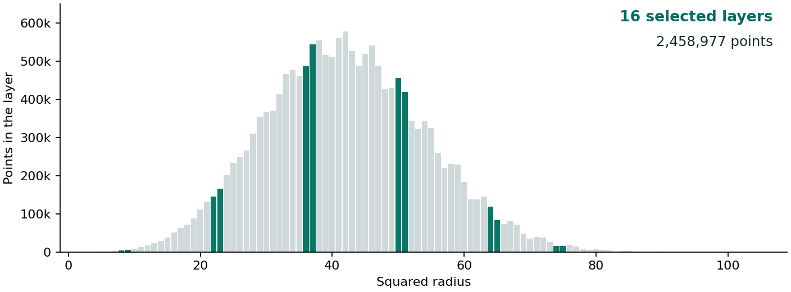

# Complete squared-norm layers in a Behrend digit cube

OpenAI Codex, prepared for Jordan Pollard, 27 November 2026  
AI-generated mathematical manuscript for public review.

For integers $q,d\ge1$ let $C=\{0,1,\ldots,q\}^d$ and $L_r=\{x\in C:\sum x_i^2=r\}$. Write $M(q,d)$ for the maximum size of a three-term-progression-free union of complete layers. A progression here is $y-v,y,y+v$ with nonzero integer vector $v$.

**Theorem.** For $q\ge3$ put $P(q,d)=\max_r(|L_r|+|L_{r+1}|)$. For $q=2$ use the sum of the largest even-index and largest odd-index layers. There are absolute positive constants $c,C_0$ such that, uniformly for all $q\ge2$ as $d\to\infty$,
$$
 0\le M(q,d)-P(q,d)\le C_0(q+1)^d q^{-2}e^{-cd}.
$$
Consequently, with $\sigma_q^2=q(2q+1)(8q^2+13q-6)/180$,
$$
 M(q,d)=(2+o(1))\frac{(q+1)^d}{\sigma_q\sqrt{2\pi d}},
$$
uniformly even when $q$ depends arbitrarily on $d$. For $q=1$ the whole cube is progression-free.

These layers give integer constructions through base $2q+1$ digit encoding, since both sides of $x+z=2y$ add without carries. The theorem concerns unions containing every lattice point of each selected layer. The unrestricted asymptotic in Erdős #142 remains open. Elkin's annulus construction and the probabilistic treatment of Green and Wolf allow selective deletion.

## 1. Layers that can always be combined

The endpoint energies of a progression have sum $2|y|^2+2|v|^2$. If it fits in two consecutive layers, its midpoint must be in the lower layer, both endpoints must be in the upper one, and $|v|^2=1$. Equality of the endpoint energies then gives $y\cdot v=0$. The changed coordinate of $y$ is zero, so one endpoint leaves the nonnegative orthant. In the ternary cube every changed coordinate has $y_i=1$ and $v_i=\pm1$. If both endpoints are in the upper layer and their energies agree, $y\cdot v=0$ forces an even number of changes. If only one endpoint shares the midpoint's lower energy, the layer gap is $2|v|^2$, also even. Thus any two layers of opposite parity in the ternary cube are safe. This proves $P\le M$.

## 2. Building a progression through two prescribed layers

Suppose $g\ge2$, $r\ge g+3$, and
$$
 dq^2-r\ge 9g+15q^2. \tag{1}
$$
Then $L_r$ contains a midpoint with both endpoints in $L_{r+g}$ whenever $q\ge3$, and also for $q=2$ when $g$ is even.

For an odd $g$, first use midpoint coordinates $(1,1,2)$ with step $(1,1,-1)$. They consume six units of midpoint energy and three units of gap. Write the remaining even gap as $2n$. Set $w=\lfloor q/2\rfloor$. Express $n$ as $\lfloor n/w^2\rfloor$ copies of $w^2$ and four further squares for the remainder, by Lagrange's theorem. For every square $t^2$ use midpoint $(t,t)$ and step $(t,-t)$. These coordinates consume the same even amount of midpoint energy and gap. All endpoints lie in the cube. Fill the remaining nonnegative midpoint energy with as many copies of $q^2$ as possible and four squares for the remainder, with step zero on all of them. The number of coordinates used is at most $r/q^2+9g/q^2+15$ since $w\ge q/3$. Pad with zeros. Orthogonality of midpoint and step gives the two required equal endpoint energies.

Write $\mu_q=q(2q+1)/6$ for the mean square of a uniform digit. For large $d$, (1) and $r\ge g+3$ hold for every pair in
$$
 |r-d\mu_q|\le dq^2/100
$$
at distance $g\ge2$. Indeed $1/3\le\mu_q/q^2\le5/12$, and the gap is at most $dq^2/50$. Thus any admissible union contains at most two consecutive central levels for $q\ge3$, and at most one level of each parity there for $q=2$.

## 3. Filling an energy deficit near the upper corner

The uniformity in $q$ requires some care. Near the top corner, a full level of small probability can have many possible indices. We give an explicit progression to restrict these indices. Put $D=dq^2-r$. In this section assume $q\ge 2^{24}$ and $d\ge100$.

First, every integer $D'$ in $[100q^{3/2},64q^2]$ is a sum of at most 73 deficits $q^2-j^2$ with $0\le j\le q$. Use copies of $q^2$ to bring $D'$ down to at most $2q^2$, leaving at least $q^2$ whenever a copy was used. If the remainder is odd subtract $2q-1$, the deficit of digit $q-1$. The remaining even value $E$ is between $90q^{3/2}$ and $2q^2$. Take the least $a$ with $8(2qa-a^2)\ge E$ on $[0,\lfloor q/2\rfloor]$. It exists, and $a\ge E/(16q)$. Successive values on the left differ by at most $16q$, so
$$
 0\le \frac{8(2qa-a^2)-E}{2}\le 8q\le a^2 .
$$
Write this integer as four squares $t_i^2$ and use the eight digits $q-a\pm t_i$. Their combined deficit is exactly $E$.

Now suppose $256q^{3/2}\le D\le64q^2$ and $g\ge2$ is even with
$$
 g\le\frac{1}{1024}\min(q^2,D^2/q^2). \tag{2}
$$
Write $g/2=\sum_{i=1}^4t_i^2$. For each $t_i$ use midpoint $(q-t_i,q-t_i)$ and step $(t_i,-t_i)$. The eight digits consume a deficit at most $4q\sum t_i\le4q\sqrt{2g}<D/2$. Their endpoints stay in the cube by (2). Fill the residual deficit by the previous paragraph and pad with digits $q$ with step zero. This produces a midpoint in $L_r$ with both endpoints in $L_{r+g}$.

## 4. The total contribution from noncentral levels

Write $X=J^2$ for a uniform digit $J$, and $S_d$ for a sum of $d$ independent copies. Jacobi's eight-square identity gives $r_8(n)\le16\zeta(3)n^3$ for $n\ge1$, counting signed and ordered representations. Thus
$$
 \sup_n\Pr(S_8=n)\ll q^{-2}.
$$
This includes $n=0$, and follows for positive $n$ by $n\le8q^2$ on the support. For any noncentral index $r$, the event $S_{d-8}\in[r-8q^2,r]$ is a deviation of at least a fixed multiple of $dq^2$ from its mean for sufficiently large $d$. Hoeffding and conditioning on the last $d-8$ digits give
$$
 \Pr(S_d=r)\ll q^{-2}e^{-c d}. \tag{3}
$$

We sum this bound over admissible indices. Changes of the absolute positive $c$ below absorb fixed factors and $\log(2+d)$.

**Middle region.** For $q^2/16\le r\le dq^2-64q^2$, split at $dq^2/2$. Partition the first half into intervals of multiplicative width $1+1/100$ in $r$, and the second half into such intervals in $D$. This uses $O(\log(2+d))$ intervals. When $r\ge10$, two distinct same-parity indices in one interval have even gap $g\le\min(r,D)/90$, taking $r,D$ at the lower energy. Then $r\ge g+3$, and $D\ge64q^2$ ensures (1). Hence each interval contains at most two selected indices. The finitely many indices below ten contribute by (3). The total noncentral mass in this region has the required bound.

**Lower edge.** For $10\le r<q^2/16$, each dyadic interval $R/2<r\le R$ can be split into an absolute number of ratio-$1+1/100$ intervals. Again (1) excludes two distinct indices of the same parity in any such interval. If $S_d=r$, each of the last $d-8$ digits is at most $\sqrt R$. Conditioning and the eight-square bound give
$$
 \Pr(S_d=r)\ll q^{-2}(2\sqrt R/q)^{d-8}.
$$
Take $R=q^2/(16\cdot2^j)$ and sum the resulting geometric series. Indices below ten use (3).

**Upper edge.** If $q<2^{24}$, the strip $D<64q^2$ has an absolute bounded number of indices, so (3) suffices. Otherwise the whole event $D<256q^{3/2}$ forces every digit to have $q-J\le256\sqrt q$, since $q^2-J^2\ge q(q-J)$. Its probability is at most $(257/\sqrt q)^d\ll q^{-2}e^{-cd}$, uniformly by $q\ge2^{24}$.

It remains to treat $256q^{3/2}\le D<64q^2$. For a dyadic band $xq^2/2<D\le xq^2$, condition (2) permits at most $O(1+x/\min(1,x^2))$ selected indices. To see this, any two same-parity indices at distance at most $q^2\min(1,x^2)/(4\cdot1024)$ give a forbidden pair by (2), applied at the larger deficit. Count each parity separately. The bands with $1/16\le x\le64$ contribute by (3), using only an absolute number of indices. For $x\le1/16$ in the remaining bands, each of the last $d-8$ digits is within $xq$ of $q$. Since $xq\ge1$ on each nonempty band, its allowed fraction is at most $2x$. Thus the mass per index is $O(q^{-2}(2x)^{d-8})$. The extra $O(1+1/x)$ indices per band leave an exponentially decreasing geometric sum.

All noncentral selected levels together have probability $O(q^{-2}e^{-cd})$. The central levels have total weight at most $P(q,d)/(q+1)^d$. This proves the first assertion of the theorem.

## 5. Evaluating the size of the best two layers

Here are details of a lattice local limit estimate uniform in the size of the alphabet. Direct summation gives $\mathbb E X=\mu_q$, $\operatorname{Var} X=\sigma_q^2\asymp q^4$. Write $\phi(t)=\mathbb E\exp(2\pi i t X)$. For any fixed small $b>0$ there is a constant $\rho_b<1$ such that
$$
 |\phi(t)|\le\rho_b\qquad(b/q^2\le |t|\le1/2,\quad q\ge2). \tag{4}
$$
For completeness, if the average of the unit phases has modulus sufficiently near one, all but (say) $1/16$ of them lie on an arbitrarily short arc about the phase of the average. This follows by averaging squared distance from that unit phase. For $1\le h,k\le M=\lfloor q/8\rfloor$ choose $j$ such that $j,j+h,j+k,j+h+k$ all lie in the digit interval and have good phases. There are at least $q+1-2M$ possible choices before excluding at most $4(q+1)/16$. Taking the mixed difference of squares gives $\|2thk\|\le\nu$ with $\nu$ arbitrarily small, where $\|\cdot\|$ is distance to the nearest integer. If $\|j\alpha\|\le\nu<1/4$ for $1\le j\le M$, then $\|\alpha\|\le\nu/M$: the nearest representatives must advance by the same increment at each step. Applying this first in $k$ and then in $h$ gives $\|2t\|\le\nu/M^2$. For $q\ge16$, this puts $t$ within $128\nu/q^2$ of zero or a half-integer. The first is excluded by taking $\nu$ small relative to $b$. At a half-integer the phases alternate with digit parity and the mean modulus is at most $1/(q+1)$; perturbing $t$ by $128\nu/q^2$ changes the mean by at most $256\pi\nu$. The finitely many smaller $q$ satisfy (4) by compactness since the digit squares include both zero and one.

Parseval and the eight-square bound give $\int_{-1/2}^{1/2}|\phi(t)|^{16}dt\ll q^{-2}$. By (4) the contribution of $|t|\ge b/q^2$ to Fourier inversion for $S_d$ is $O(q^{-2}\rho_b^{d-16})$. On the central arc put $v=2\pi\sigma_q\sqrt d\,t$. The centered, standardized digit square is uniformly bounded and has variance one, so its characteristic function at $v/\sqrt d$ is $1-v^2/(2d)+O(|v|^3/d^{3/2})$. For small enough fixed $b$, its $d$th power is bounded on the central arc by $\exp(-c v^2)$ and converges uniformly on compact $v$-intervals to $\exp(-v^2/2)$. Fourier inversion, with the phase of modulus one for any $r$, gives uniformly in $q,r$
$$
 \sigma_q\sqrt d\,\Pr(S_d=r)=
 \frac{1}{\sqrt{2\pi}}\exp\!\left(-\frac{(r-d\mu_q)^2}{2d\sigma_q^2}\right)+o(1).
$$
Two consecutive integers nearest the mean attain the claimed two-layer asymptotic, and the same estimate bounds every pair. This proves the second assertion.

## A finite construction and reproducibility

For $q=3,d=12$, the exact maximum over all unions of complete layers is **2,458,977** of the $4^{12}=16,777,216$ points. One optimizing set of squared radii is
$$
 \{1,8,9,22,23,36,37,50,51,64,65,74,75,92,100,103\}.
$$
The best adjacent pair, $41,42$, has 1,138,038 points. This example shows why the large-dimension theorem allows additional levels. The base-7 digit map converts the 16-layer example into the same number of distinct progression-free integers.

Here is the finite optimality certificate implemented in the accompanying solver. Form all triples of squared radii by adding the eight one-coordinate possibilities twelve times. Independent enumeration of multisets of those coordinate triples gives exactly the same support. Discarding constant progressions leaves 774 forbidden pairs and 5,734 forbidden triples of radii. A set of radii is feasible exactly when it contains none of these. Weight radius $r$ by the coefficient of $x^r$ in $(1+x+x^4+x^9)^{12}$. Branch on inclusion of the heaviest remaining radius. In each branch, partition the available radii into cliques of pairwise incompatible choices; adding the heaviest member's weight per clique bounds the possible gain. When including a radius, also remove choices that would complete a forbidden triple with an earlier selection. Exact integer branch and bound terminates after 165 visited nodes. The returned maximizing set is checked against every forbidden configuration.

The second script builds bulk and near-corner witnesses and verifies each coordinate and all three energies. It exhausts nonconstant ordered triples in four small cubes. The Lean 4.33.1 file proves the adjacent-layer lemma for arbitrary lists of natural coordinates and audits its axioms. The global extremal and asymptotic arguments are written proofs. Priority and external review remain open.

1. F. A. Behrend, *On sets of integers which contain no three terms in arithmetical progression*, Proc. Natl. Acad. Sci. USA 32 (1946), 331–332. [DOI](https://doi.org/10.1073/pnas.32.12.331).
2. M. Elkin, *An improved construction of progression-free sets*. [arXiv:0801.4310](https://arxiv.org/abs/0801.4310).
3. K. S. Williams, *An arithmetic proof of Jacobi's eight squares theorem*. [Paper](https://people.math.carleton.ca/~williams/papers/pdf/236.pdf).
4. [Mathlib's formalization of the Behrend sphere and digit map](https://leanprover-community.github.io/mathlib4_docs/Mathlib/Combinatorics/Additive/AP/Three/Behrend.html).
