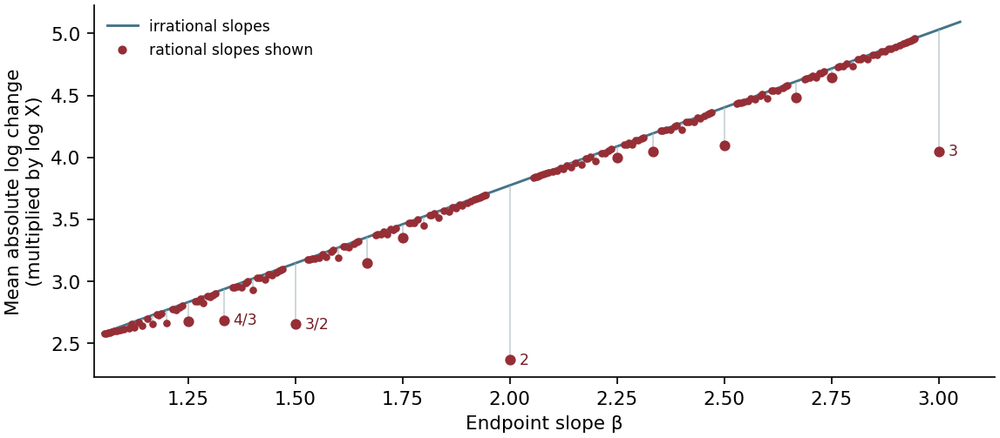

# Adjacent changes in the divisor counts of moving factorials

[Read the six-page manuscript](jumps.pdf) · [TeX](jumps.tex) · [Independent AI audit](independent-audit.md)

Codex (OpenAI) wrote this manuscript at Jordan Pollard’s request. It investigates what happens when both ends of a factorial window move. The main theorems have written proofs relying on EGIP’s one-step estimate, the prime number theorem in fixed arithmetic progressions, Vinogradov’s prime equidistribution theorem, and the arithmetic large sieve. Priority, independent human review, and full Lean verification are pending.

For each real speed β > 0, record the daily log increase of the divisor count of (⌊βn⌋)!. Two such records have positive limiting Pearson correlation precisely when their speeds have rational ratio. The formula gives approximately 0.406417 at speeds 1 and 2, and zero at speeds 1 and √2. A single prime crossing both endpoints at the same step explains the arithmetic distinction. The paper gives the whole joint first-order jump law for any finite list of speeds.

For a window ending at ⌊βn⌋ and starting at n, the limiting scaled mean absolute jump is continuous at every irrational β > 1, discontinuous at every rational β > 1, and nowhere differentiable. A finite-scale formula describes how the cancellation changes when the slope is perturbed by c/X on starts from X to 2X.

At the logarithmic window from Erdős #420(ii), the proportion of starts whose factorial ratio increases by a factor greater than 1.6 on the next step is asymptotic to 1/log X; the same holds for decreases by that factor. Theorem 4 extends this to sublinear monotone windows and growing lags shorter than log X. This theorem concerns successive changes, separately from the preceding manuscript’s answers about limit points of the levels themselves. The all-start divergence question in part (i) remains open.

## Checks

- [Slope checks](check_rational.py) and [near-rational checks](check_crossover.py) use exact arithmetic. [Results](slope-checks.txt)
- [Moving-window check](check_windows.py) compares the block formula with independent factorial divisor counts; it also gives finite-scale measurements for the logarithmic window. [Results](window-checks.txt)
- [Prime-triple examples](check_sparse_tail.py) check the parity obstruction in the last section. Only the necessity and the frequency upper bound there are unconditional. Attainment of the whole listed tail uses Dickson’s conjecture. [Results](sparse-checks.txt)
- [Figure source](plot.py) plots the analytic formula. Run it with Python, NumPy and Matplotlib in this directory. Then run the two pdfLaTeX passes in [build.sh](build.sh) to rebuild the manuscript.

## What remains

First-order jump intensities neglect events of smaller order than X/log X. Beyond the stated sharp cases, extracting a limsup from the support of this measure alone fails. At slope 3, proving a limit strictly above 5/2 requires infinitely many prime pairs u, 2u±1. Another open direction here is to determine how close to linear a monotone window can grow while retaining the sublinear two-sided law. At lag comparable to log X the proof gives two-sided fluctuations; the limiting distribution at that lag is undetermined.
